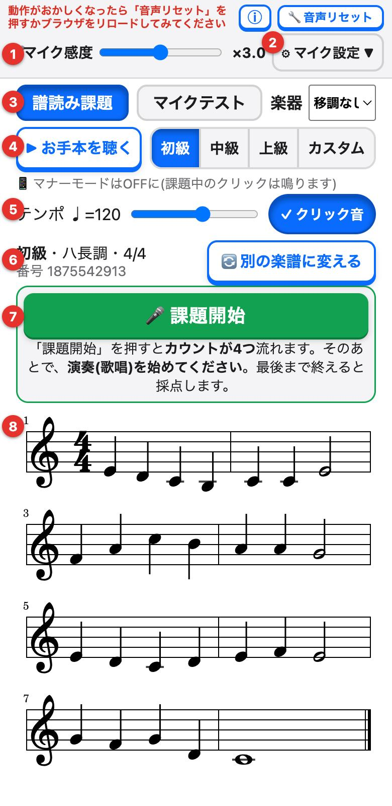
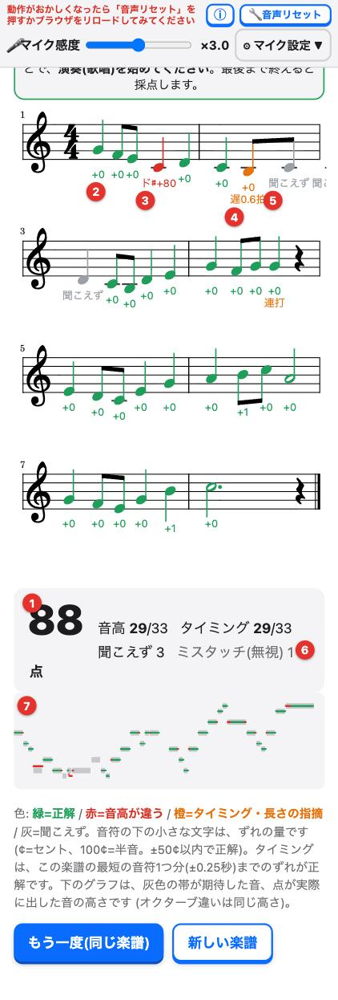

# ソルフェージュ自習

[](https://github.com/BigmacTaro/Taro-solfege-app/actions/workflows/deploy.yml)
[](https://github.com/BigmacTaro/Taro-solfege-app/actions/workflows/ci.yml)

楽譜を見て**歌う・楽器で演奏する**と、**音の高さとタイミング**を自動で採点する、譜読み(ソルフェージュ)の自習Webアプリです。
スマホやタブレットのブラウザから、そのまま使えます(インストール不要)。

**▶ [アプリを使う](https://bigmactaro.github.io/Taro-solfege-app/)** ・ [仕様と使い方(採点方式など)](https://bigmactaro.github.io/Taro-solfege-app/spec.html)

<p>
  
  
</p>

## 特徴

- **自動で楽譜を作る**: 楽典に沿った8小節の旋律を、毎回、自動で作ります(動機と楽節、和声、傾向音の解決、終止など)。
- **難易度**: 初級(ハ長調・4/4)から、上級(22調・4/4・3/4・6/8、十六分音符、付点、三連符、小節をまたぐタイ)まで。拍子・最短の音符・シンコペーション・調(チャーチモードを含む)を選べる**カスタム**もあります。
- **マイクで採点**: 音の高さ(±50セント)とタイミング(最短の音符1つ分)を判定し、楽譜に色分けと、ずれの量で結果を出します。オクターブ違いは同じ音として扱います。
- **移調楽器に対応**: B♭管、E♭管(アルト・バリトン)、テナーサックス、ホルン、A管。楽譜は記譜音、判定は実音です。
- **お手本とメトロノーム**: お手本の再生、カウントイン、拍の点滅(クリック音は消せます)。
- **ミスタッチに寛容**: 一瞬だけ別の音が鳴っても、減点しません。
- **サーバー不要の静的サイト**: マイクの音は端末の中だけで処理し、録音の保存も送信もしません。設定は、ブラウザに保存します。

## 対応環境

- スマホ・タブレット・パソコンの最近のブラウザ(iPhoneのSafari、Android/パソコンのChrome など)。
- マイクが使える端末。マイクの利用には、**HTTPS(または localhost)**が必要です。
- 声でも楽器でも使えます。マイクが拾うのは、1度に1つの音(単旋律)です。

## 開発

### 必要なもの

- Node.js 22 以上(`.nvmrc`)

### コマンド

```bash
npm ci          # 依存パッケージを入れる
npm run dev     # 開発サーバー(http://localhost:5173)
npm test        # 自動テスト(楽譜の生成と判定のロジック)
npm run build   # 本番用のビルド(dist/)。ライセンス表記ページも自動で作り直す
npm run preview # ビルドした結果を確認する
```

スマホの実機で、マイクを使って確かめるには、HTTPSで開く必要があります(LANのIPアドレスの `http://` では、マイクが許可されません)。
`main` ブランチへ push すると、GitHub Pagesに公開されるので、公開版を、スマホで確認できます。

### 構成

```
src/
  App.tsx, main.tsx, style.css   アプリの入口・タブ・スタイル
  ScoreTab.tsx                   「譜読み課題」(出題・再生・録音・採点の流れ)
  PitchLab.tsx                   「マイクテスト」(音名とずれのリアルタイム表示)
  Header.tsx / AboutDialog.tsx   上部の設定 / 初回の説明
  ScoreView.tsx / ResultTimeline.tsx   楽譜の描画(VexFlow)/ 結果のグラフ
  music/score.ts                 楽譜のデータ(調・拍子・音符・タイ)と、音の綴り
  music/generator.ts             楽譜の自動生成
  eval/evaluate.ts               マイクの記録を、楽譜と照合して採点
  audio/                         マイク入力(mic)・再生とメトロノーム(player)・音声の復旧(engine)
  pitch.ts                       基本周波数の推定(YIN)
public/
  spec.html, licenses.html       仕様と使い方 / オープンソースのライセンス表記
scripts/                         ライセンス表記ページの生成、テストの実行
tests/                           自動テスト(Nodeの組み込みテストランナー)
SPEC.md                          設計メモ(仕様と決定事項)
```

### 技術

[React](https://react.dev/) + TypeScript + [Vite](https://vite.dev/)、音は [Tone.js](https://tonejs.github.io/)(Web Audio)、楽譜は [VexFlow](https://www.vexflow.com/)。
マイクの音程検出は、YINアルゴリズムを自前で実装しています(`src/pitch.ts`)。

### 公開

`main` への push で、GitHub Actions(`.github/workflows/deploy.yml`)が、テストとビルドを行い、GitHub Pagesに公開します。
リポジトリの Settings → Pages で、Source を「GitHub Actions」にしてください。

## ドキュメント

- [SPEC.md](SPEC.md): 仕様と決定事項(開発者向け)
- [CONTRIBUTING.md](CONTRIBUTING.md): 開発への参加方法
- [仕様と使い方(利用者向け)](https://bigmactaro.github.io/Taro-solfege-app/spec.html)

## ライセンス

- **このプロジェクト**(このリポジトリのソースコード・説明ページ・スクリーンショット)は、**[0BSD](LICENSE)** です。コピー・改変・再配布・商用利用を、著作権表示も含めて、制限なく自由にできます。
- **使っているオープンソースのソフトウェアと書体**は、それぞれのライセンスに従います: React、Tone.js、VexFlow など(MIT・0BSD)と、書体のBravura・Academico(SIL Open Font License 1.1)。
  著作権表示とライセンス全文は、[公開版のライセンス表記](https://bigmactaro.github.io/Taro-solfege-app/licenses.html)(`public/licenses.html`)にあります。このページは、ビルドのたびに自動で作られます。
  これらを含む形で、このアプリを再配布するときは、上記のライセンス表記を、同じように残してください。
